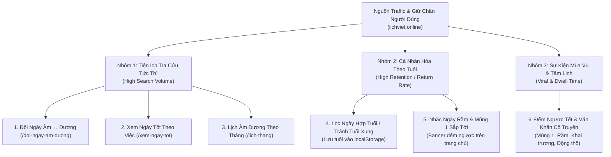

# Nghiên Cứu Tính Năng Thu Hút & Giữ Chân Người Dùng (`lichviet.online`)

## 1. Giải Quyết Điểm Nghẽn UX: "Tại sao tính năng Đổi Ngày bị ẩn và làm sao để User biết?"

### Vấn đề hiện tại
- Trên trang chủ hiện tại, tính năng **Đổi Ngày Dương ↔ Âm** đang nằm trong tab thứ 2 của Popover chỉ mở ra khi bấm vào chữ `Tháng 11, 2026` trên [`CalendarHeader.tsx`](file:///Users/bangca/bangca/personal/lich-viet-van-su-an-lanh/web/src/components/calendar/CalendarHeader.tsx).
- **Hệ quả UX**: Người dùng mới vào trang chỉ nhìn thấy chữ `Tháng 11, 2026 ▾` (tưởng chỉ dùng để chọn tháng) và nút `Hôm nay`. Họ **không hề biết** website có công cụ đổi ngày Âm ↔ Dương 2 chiều.
- **Hệ quả SEO**: Người dùng tìm kiếm *"đổi ngày âm dương"*, *"đổi lịch âm sang dương"* trên Google cần một URL đích riêng biệt (`/doi-ngay-am-duong`). Việc nhét công cụ này vào một Popover ẩn trên `/` khiến Google không thể xếp hạng trang đích riêng cho nhóm từ khóa có lưu lượng cực lớn này.

### Giải pháp 3 Lớp (Hiển thị trực diện + Tối ưu SEO)
1. **Lớp 1 — Nút "⇄ Đổi ngày Âm - Dương" nổi bật ngay trên Thanh Điều Khiển Lịch (`CalendarHeader.tsx`)**:
   - Đặt nút bấm độc lập **`⇄ Đổi ngày`** nằm cạnh nút **`Hôm nay`** trên [`CalendarHeader.tsx`](file:///Users/bangca/bangca/personal/lich-viet-van-su-an-lanh/web/src/components/calendar/CalendarHeader.tsx).
   - Khi bấm vào nút này, mở thẳng tab **"Đổi ngày Âm ↔ Dương"** (trong khi bấm vào `Tháng 11, 2026` mở tab **"Chọn tháng/năm"**).
2. **Lớp 2 — Đưa "Đổi Ngày" và "Xem Ngày Tốt" lên Thanh Menu Chính (`TopHeader.tsx`)**:
   - Nâng cấp thanh điều hướng chính trên [`TopHeader.tsx`](file:///Users/bangca/bangca/personal/lich-viet-van-su-an-lanh/web/src/components/layout/TopHeader.tsx) từ 2 mục (`Lịch`, `Sự Kiện`) lên 4 mục cốt lõi:
     - **Lịch Tháng** (`/`)
     - **Đổi Ngày Âm Dương** (`/doi-ngay-am-duong`)
     - **Xem Ngày Tốt** (`/xem-ngay-tot`)
     - **Sự Kiện & Lễ Tết** (`/holidays`)
3. **Lớp 3 — Trang Đích SEO Độc Lập (`/doi-ngay-am-duong`)**:
   - Trang công cụ chuyển đổi Dương lịch ↔ Âm lịch toàn màn hình với kết quả tức thì: Ngày Âm/Dương tương ứng, Can Chi (Ngày/Tháng/Năm), Tiết khí, Ngày Hoàng Đạo/Hắc Đạo, Giờ Hoàng Đạo và nút **"Xem chi tiết phong thủy ngày này"** dẫn sang `/day/YYYY-MM-DD`.

---

## 2. Phân Tích Nhu Cầu Tìm Kiếm & Khoảng Trống Tính Năng So Với Đối Thủ (Competitor & Feature Gap)

Qua khảo sát cấu trúc sản phẩm và nhóm trang mang lại lưu lượng truy cập tự nhiên (Organic Traffic) lớn nhất của các chuyên trang lịch vạn niên hàng đầu tại Việt Nam (`lichngaytot.com`, `lichviet.app`, `xemlicham.com`), hành vi người dùng tập trung vào **6 nhóm tính năng chủ lực**:

### Bảng Đánh Giá Các Tính Năng Kéo Traffic & Tận Dụng Dữ Liệu Sẵn Có

| Ưu tiên | Tính năng đề xuất | Từ khóa mục tiêu (Search Intent) | Mức độ sẵn sàng dữ liệu trong Codebase | Tác động kỳ vọng |
| :---: | :--- | :--- | :--- | :--- |
| **P0 (Làm ngay)** | **1. Nút nổi bật & Trang `/doi-ngay-am-duong`** | *đổi ngày âm dương, đổi lịch âm sang dương, tra ngày âm lịch* (Transactional / Utility) | **Đã có 100%** (`LunarCalculator.toLunar`, `LunarCalculator.toSolar`, `FengShuiServerRepository`) | Giải quyết ngay bài toán "user không biết có tính năng đổi ngày" + Mở trang đích SEO hút traffic lớn. |
| **P0 (Làm ngay)** | **2. Trang "Xem Ngày Tốt Theo Tháng & Việc" (`/xem-ngay-tot`)** | *xem ngày tốt tháng 11, ngày tốt cưới hỏi, ngày tốt khai trương, ngày tốt động thổ, ngày tốt xuất hành* | **Đã có 100%** (Trường `t12g`, `ga`, `ba`, `s28`, `age`, `ghd` trong JSON 2025–2027) | Biến dữ liệu JSON sẵn có thành bảng xếp hạng các ngày đẹp nhất trong tháng kèm điểm số & Giờ Hoàng Đạo. |
| **P1 (Giá trị giữ chân cao)** | **3. Cá nhân hóa "Xem Ngày Hợp Tuổi / Tránh Tuổi Xung"** | *xem ngày tốt hợp tuổi, ngày xung tuổi, xem ngày theo tuổi* | **Đã có sẵn trường `age` (Tuổi xung)** trong `DayFengShuiData`! | Người dùng chọn Năm sinh 1 lần (lưu `localStorage`). Mọi ngày trên lịch sẽ báo ngay **"Hợp tuổi"** hoặc **"Xung tuổi của bạn"** → Tăng tỷ lệ quay lại (Retention). |
| **P1 (Kéo khách định kỳ)** | **4. Thanh thông báo "Sắp tới Mùng 1 / Ngày Rằm & Đếm ngược Lễ Tết"** | *hôm nay âm lịch ngày mấy, bao giờ đến rằm, đếm ngược Tết 2027* | **Đã có 100%** (`LunarCalculator` + `HolidayRepository`) | Người Việt tra lịch nhiều nhất trước ngày Mùng 1 và Rằm. Hiển thị chip *"Rằm tháng 10 ÂL: còn X ngày"* ngay đầu trang giúp giữ chân user mỗi nửa tháng. |
| **P2 (SEO Dài Hạn)** | **5. Trang Lịch Tháng độc lập (`/thang/[year]-[month]`)** | *lịch âm tháng 11 2026, lịch âm tháng 12 2026, lịch vạn niên tháng 1 2027* | **Đã có 100%** | Hiện tại link 12 tháng ở Footer trỏ về `/day/2026-MM-01`. Có URL riêng cho từng tháng giúp tối ưu chuẩn xác cụm từ khóa *"lịch âm tháng X"*. |
| **P2 (Tăng thời gian đọc)** | **6. Thư viện Văn Khấn Cổ Truyền (Mùng 1, Rằm, Ông Công Ông Táo, Khai trương)** | *văn khấn mùng 1, văn khấn ngày rằm, văn khấn thần tài* | Cần bổ sung file JSON văn khấn tĩnh (~20 bài phổ biến) | Nút *"Xem bài văn khấn"* xuất hiện đúng vào ngày Mùng 1 / Rằm / Lễ Tết giúp tăng thời gian ở lại trang (Dwell Time) lên 3–5 phút. |

---

## 3. Đề Xuất Triển Khai Ngay (Phase 6 — User Acquisition & Feature Visibility)

Chúng ta có thể triển khai ngay **Gói Nâng Cấp Hiển Thị & Kéo Traffic (Phase 6)** mà không cần thêm bất kỳ thư viện ngoài nào (tận dụng 100% `LunarCalculator` và `FengShuiServerRepository` sẵn có):

1. **Làm nổi bật tính năng Đổi Ngày ngay trên Trang chủ**:
   - Thêm nút **`⇄ Đổi ngày Âm - Dương`** tách biệt, rõ ràng ngay trên [`CalendarHeader.tsx`](file:///Users/bangca/bangca/personal/lich-viet-van-su-an-lanh/web/src/components/calendar/CalendarHeader.tsx) (cạnh nút `Hôm nay`) và thêm chip nhắc **"Mùng 1 / Rằm sắp tới"**.
   - Đưa **`Đổi Ngày`** (`/doi-ngay-am-duong`) và **`Ngày Tốt`** (`/xem-ngay-tot`) lên thanh menu [`TopHeader.tsx`](file:///Users/bangca/bangca/personal/lich-viet-van-su-an-lanh/web/src/components/layout/TopHeader.tsx).
2. **Xây dựng trang `/doi-ngay-am-duong` (Công cụ Đổi Ngày Âm ↔ Dương chuẩn SEO)**:
   - Giao diện chuyển đổi 2 chiều trực quan, hiển thị ngay thẻ kết quả (Ngày Dương, Ngày Âm, Can Chi, Tiết Khí, Hoàng Đạo/Hắc Đạo, Giờ Tốt, Việc Nên Làm) + nút xem chi tiết ngày.
3. **Xây dựng trang `/xem-ngay-tot` (Tra cứu Ngày Tốt theo Công Việc & Lọc Tránh Tuổi Xung)**:
   - Cho phép chọn **Tháng/Năm**, **Công việc** (*Cưới hỏi, Khai trương, Động thổ/Xây dựng, Xuất hành, Nhập trạch, Ký kết*) và **Con giáp / Năm sinh của gia chủ** (để tự động loại bỏ các ngày xung tuổi dựa trên trường `age` trong dữ liệu Phong Thủy).
   - Bổ sung cả `/doi-ngay-am-duong` và `/xem-ngay-tot` vào `sitemap.xml`.
