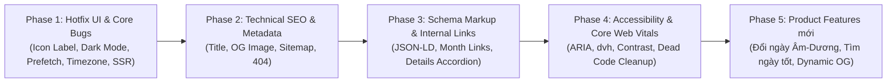

# Kế Hoạch Nâng Cấp Website `lichviet.online` (Web Enhancement Plan)

Tài liệu tham chiếu: [website_enhancement_audit.md](file:///Users/bangca/bangca/personal/lich-viet-van-su-an-lanh/docs/website_enhancement_audit.md)

---

## 🎯 Mục Tiêu Tổng Quan

Khắc phục triệt để các lỗi giao diện/hiệu năng/SEO đang xảy ra trên bản Production `https://www.lichviet.online/` và nâng cấp các tính năng trải nghiệm người dùng theo 5 Phase rõ ràng:

---

## 🚀 PHASE 1: Hotfix Giao Diện & Lỗi Logic Nghiêm Trọng (Ưu tiên P0 - Làm ngay)

### 1.1. Sửa lỗi hiển thị chữ Label của toàn bộ Icon (`ark_mo`, `calendar_month`, `chevron_left`...)
- **Files**:
  - [web/src/components/common/MaterialIcon.tsx](file:///Users/bangca/bangca/personal/lich-viet-van-su-an-lanh/web/src/components/common/MaterialIcon.tsx)
  - [web/src/app/layout.tsx](file:///Users/bangca/bangca/personal/lich-viet-van-su-an-lanh/web/src/app/layout.tsx)
  - [web/src/app/globals.css](file:///Users/bangca/bangca/personal/lich-viet-van-su-an-lanh/web/src/app/globals.tsx)
- **Công việc**:
  - [x] Thay thế hoàn toàn font icon Google Fonts Material Symbols (~3.4 MB) bằng component vector SVG nội tuyến [MaterialIcon.tsx](file:///Users/bangca/bangca/personal/lich-viet-van-su-an-lanh/web/src/components/common/MaterialIcon.tsx) cho toàn bộ 28 icon trên khắp ứng dụng (`TopHeader`, `CalendarHeader`, `HomeClient`, `DayDetailPanelClient`, `InfoSections`, `holidays`, `download`, `privacy`, `terms`) và xóa `MaterialSymbolsLoader.tsx`.
  - [x] Bổ sung quy tắc CSS phòng vệ cố định kích thước cho `.material-symbols-outlined` trong `@layer components` của [globals.css](file:///Users/bangca/bangca/personal/lich-viet-van-su-an-lanh/web/src/app/globals.css) (`display: inline-block; width: 1em; height: 1em; overflow: hidden; white-space: nowrap; direction: ltr;`) để ngăn chặn vĩnh viễn hiện tượng tràn chữ (`ark_mo`, `chevron_left`).

### 1.2. Sửa lỗi nền đen Dark Mode lệch tông ở thẻ "Nên làm" / "Kiêng kỵ"
- **Files**:
  - [web/tailwind.config.ts](file:///Users/bangca/bangca/personal/lich-viet-van-su-an-lanh/web/tailwind.config.ts)
  - [web/src/components/home/DayDetailPanelClient.tsx](file:///Users/bangca/bangca/personal/lich-viet-van-su-an-lanh/web/src/components/home/DayDetailPanelClient.tsx)
  - [web/src/components/home/CalendarGridClient.tsx](file:///Users/bangca/bangca/personal/lich-viet-van-su-an-lanh/web/src/components/home/CalendarGridClient.tsx)
- **Công việc**:
  - [x] Thêm `darkMode: "class"` vào [tailwind.config.ts](file:///Users/bangca/bangca/personal/lich-viet-van-su-an-lanh/web/tailwind.config.ts) để các class `dark:*` không tự kích hoạt lệch tông khi hệ điều hành bật Dark Mode.
  - [x] Đồng bộ màu chữ và nền sáng của thẻ *"Nên làm"* và *"Kiêng kỵ"* giữa Desktop (`DayDetailPanelClient.tsx`) và Mobile (`HomeClient.tsx`).

### 1.3. Chặn bão 42+ request Prefetch & Sửa hành vi click chọn ngày trên Trang chủ
- **Files**:
  - [web/src/components/home/CalendarGridClient.tsx](file:///Users/bangca/bangca/personal/lich-viet-van-su-an-lanh/web/src/components/home/CalendarGridClient.tsx)
- **Công việc**:
  - [x] Thêm `prefetch={false}` vào `<Link href="/day/YYYY-MM-DD">` trong `CalendarDayCellClient` để ngăn Next.js bắn 42+ request prefetch đồng loạt khi mở trang.
  - [x] Khi ở Trang chủ (có truyền `onSelectDate`), ngăn điều hướng chuyển trang khi click đơn vào ô ngày (`e.preventDefault(); onSelect(date)`) để cập nhật mượt mà cột `DayDetailPanelClient` bên phải (vẫn giữ thẻ `<a href="/day/...">` để hỗ trợ SEO crawl và mở tab mới bằng Chuột giữa / Cmd+Click).

### 1.4. Sửa lỗi đóng băng ngày tĩnh trên Trang chủ & Khôi phục SSR cho Bảng chi tiết ngày
- **Files**:
  - [web/src/app/page.tsx](file:///Users/bangca/bangca/personal/lich-viet-van-su-an-lanh/web/src/app/page.tsx)
  - [web/src/components/home/HomeClient.tsx](file:///Users/bangca/bangca/personal/lich-viet-van-su-an-lanh/web/src/components/home/HomeClient.tsx)
- **Công việc**:
  - [x] Thêm `export const revalidate = 3600;` vào [page.tsx](file:///Users/bangca/bangca/personal/lich-viet-van-su-an-lanh/web/src/app/page.tsx) và tạo helper lấy ngày hiện tại theo múi giờ Việt Nam (`Asia/Ho_Chi_Minh`, UTC+7).
  - [x] Trong [HomeClient.tsx](file:///Users/bangca/bangca/personal/lich-viet-van-su-an-lanh/web/src/components/home/HomeClient.tsx), khởi tạo `useState<DayFengShuiData | null>(initialFengShuiData)` và `useState(false)` cho `isLoading` để HTML từ server hiển thị ngay chi tiết ngày hôm nay (không bị nháy khung xương `animate-pulse`).

### 1.5. Sửa lỗi lệch 1 ngày theo múi giờ UTC trên `/day/[date]` & xử lý 404
- **Files**:
  - [web/src/app/day/[date]/page.tsx](file:///Users/bangca/bangca/personal/lich-viet-van-su-an-lanh/web/src/app/day/[date]/page.tsx)
  - [web/src/components/day-detail/DayDetailContentClient.tsx](file:///Users/bangca/bangca/personal/lich-viet-van-su-an-lanh/web/src/components/day-detail/DayDetailContentClient.tsx)
- **Công việc**:
  - [x] Tạo hàm `parseLocalDate(dateStr: string): Date | null` kiểm tra định dạng `^\d{4}-\d{2}-\d{2}$` và khởi tạo `new Date(year, month - 1, day)` thay vì `new Date(dateString)` (tránh lệch sang ngày hôm trước trên máy chủ UTC-5/UTC-8 của Googlebot).
  - [x] Gọi `notFound()` trong [day/[date]/page.tsx](file:///Users/bangca/bangca/personal/lich-viet-van-su-an-lanh/web/src/app/day/[date]/page.tsx) nếu `date` không hợp lệ hoặc ngoài khoảng năm dữ liệu.

---

## 🔍 PHASE 2: Nâng Cấp Technical SEO & Metadata (`technical-seo-audit`)

### 2.1. Sửa lỗi lặp `| Lịch Việt | Lịch Việt` trong `<title>` và mất `og:image`
- **Files**:
  - [web/src/app/layout.tsx](file:///Users/bangca/bangca/personal/lich-viet-van-su-an-lanh/web/src/app/layout.tsx)
  - [web/src/app/holidays/layout.tsx](file:///Users/bangca/bangca/personal/lich-viet-van-su-an-lanh/web/src/app/holidays/layout.tsx)
  - [web/src/app/download/layout.tsx](file:///Users/bangca/bangca/personal/lich-viet-van-su-an-lanh/web/src/app/download/layout.tsx)
  - [web/src/app/privacy/layout.tsx](file:///Users/bangca/bangca/personal/lich-viet-van-su-an-lanh/web/src/app/privacy/layout.tsx)
  - [web/src/app/terms/layout.tsx](file:///Users/bangca/bangca/personal/lich-viet-van-su-an-lanh/web/src/app/terms/layout.tsx)
  - [web/src/app/not-found.tsx](file:///Users/bangca/bangca/personal/lich-viet-van-su-an-lanh/web/src/app/not-found.tsx)
  - [web/src/app/day/[date]/page.tsx](file:///Users/bangca/bangca/personal/lich-viet-van-su-an-lanh/web/src/app/day/[date]/page.tsx)
- **Công việc**:
  - [x] Loại bỏ hậu tố `| Lịch Việt` bị lặp trong `title` của tất cả các layout/page con (để `title.template: "%s | Lịch Việt"` ở root layout tự động gắn 1 lần duy nhất).
  - [x] Bổ sung `images: [{ url: "/og-image.webp", width: 1200, height: 630, alt: "Lịch Việt - Vạn Sự An Lành" }]` và `siteName: "Lịch Việt - Vạn Sự An Lành"` vào `openGraph` của tất cả các trang con.
  - [x] Sửa `authors.url` trong [layout.tsx](file:///Users/bangca/bangca/personal/lich-viet-van-su-an-lanh/web/src/app/layout.tsx#L50) từ `https://lichviet.vn` thành `https://lichviet.online`.
  - [x] Giàu hóa `<title>` và `<meta name="description">` của `/day/[date]` với Ngày Âm lịch, Can Chi và trạng thái Hoàng Đạo/Hắc Đạo (ví dụ: `"Ngày 6/11/2026 (28/9 Âm lịch - Ngày Giáp Thân, Hoàng Đạo)"`).

### 2.2. Chuẩn hóa `sitemap.xml` khớp với dữ liệu thực tế
- **Files**:
  - [web/src/app/sitemap.ts](file:///Users/bangca/bangca/personal/lich-viet-van-su-an-lanh/web/src/app/sitemap.ts)
- **Công việc**:
  - [x] Sử dụng `FengShuiServerRepository.getAvailableYears()` (`[2025, 2026, 2027]`) để sinh danh sách URL `/day/YYYY-MM-DD`, loại bỏ 366 URL rỗng của năm 2028 khỏi `sitemap.xml`.

---

## 🧩 PHASE 3: Chuẩn Hóa Schema Markup & Liên Kết Nội Bộ (`schema-markup` & `internal-link-audit`)

### 3.1. Sửa lỗi & Gắn JSON-LD Structured Data vào các trang đích
- **Files**:
  - [web/src/components/seo/JsonLd.tsx](file:///Users/bangca/bangca/personal/lich-viet-van-su-an-lanh/web/src/components/seo/JsonLd.tsx)
  - [web/src/app/day/[date]/page.tsx](file:///Users/bangca/bangca/personal/lich-viet-van-su-an-lanh/web/src/app/day/[date]/page.tsx)
  - [web/src/app/download/layout.tsx](file:///Users/bangca/bangca/personal/lich-viet-van-su-an-lanh/web/src/app/download/layout.tsx)
- **Công việc**:
  - [x] Xóa `SearchAction` không hợp lệ (`/day/{search_term_string}`) khỏi `WebsiteJsonLd` và thêm `@id: "https://lichviet.online/#website"`.
  - [x] Xóa `aggregateRating` giả định khỏi `SoftwareApplicationJsonLd`, cập nhật `operatingSystem: "iOS"` khớp với nội dung hiển thị trên trang `/download` và render trong `download/layout.tsx`.
  - [x] Cập nhật `DayPageJsonLd` (thêm `url`, `mainEntityOfPage`, `image`, cố định `datePublished`) và render cùng `BreadcrumbJsonLd` trong [day/[date]/page.tsx](file:///Users/bangca/bangca/personal/lich-viet-van-su-an-lanh/web/src/app/day/[date]/page.tsx).

### 3.2. Giảm Crawl Depth từ >300 clicks xuống ≤ 3 clicks & Mở khóa nội dung Accordion cho SEO
- **Files**:
  - [web/src/components/layout/Footer.tsx](file:///Users/bangca/bangca/personal/lich-viet-van-su-an-lanh/web/src/components/layout/Footer.tsx)
  - [web/src/components/home/InfoSections.tsx](file:///Users/bangca/bangca/personal/lich-viet-van-su-an-lanh/web/src/components/home/InfoSections.tsx)
- **Công việc**:
  - [x] Thêm thanh liên kết nhanh **Lịch 12 Tháng** (`Tháng 1` → `Tháng 12` trỏ tới `/day/{year}-{month}-01` với `prefetch={false}`) trong [Footer.tsx](file:///Users/bangca/bangca/personal/lich-viet-van-su-an-lanh/web/src/components/layout/Footer.tsx) để Googlebot và người dùng có thể truy cập bất kỳ tháng nào trong năm chỉ với 1 click.
  - [x] Chuyển [InfoSections.tsx](file:///Users/bangca/bangca/personal/lich-viet-van-su-an-lanh/web/src/components/home/InfoSections.tsx) từ conditional rendering `{expandedId === item.id && ...}` sang thẻ `
` & `
` chuẩn HTML5 để nội dung *28 Sao, 12 Trực, Giờ Hoàng Đạo* luôn nằm trong SSR DOM cho Google index và hỗ trợ `Ctrl+F`.

---

## ♿ PHASE 4: Accessibility (A11y), Responsive & Dọn Dẹp Codebase (`a11y-debugging` & `modern-web-guidance`)

### 4.1. Chuẩn hóa Heading (`<h1>`), `aria-label`, `aria-hidden` và Độ tương phản
- **Files**:
  - [web/src/components/layout/TopHeader.tsx](file:///Users/bangca/bangca/personal/lich-viet-van-su-an-lanh/web/src/components/layout/TopHeader.tsx)
  - [web/src/components/calendar/CalendarHeader.tsx](file:///Users/bangca/bangca/personal/lich-viet-van-su-an-lanh/web/src/components/calendar/CalendarHeader.tsx)
  - [web/src/components/day-detail/DayHeaderCard.tsx](file:///Users/bangca/bangca/personal/lich-viet-van-su-an-lanh/web/src/components/day-detail/DayHeaderCard.tsx)
  - [web/src/app/holidays/page.tsx](file:///Users/bangca/bangca/personal/lich-viet-van-su-an-lanh/web/src/app/holidays/page.tsx)
  - [web/src/components/layout/Footer.tsx](file:///Users/bangca/bangca/personal/lich-viet-van-su-an-lanh/web/src/components/layout/Footer.tsx)
- **Công việc**:
  - [x] Thêm `aria-hidden="true"` cho tất cả icon ``.
  - [x] Thêm `aria-label` tiếng Việt cho các nút chuyển tháng Trước/Sau, nút cuộn ngang Giờ Hoàng Đạo / Danh mục sự kiện, và bọc ô tìm kiếm sự kiện trong thẻ `<search>`.
  - [x] Đổi `<h1 className="hidden sm:block">Lịch Việt</h1>` trong `TopHeader.tsx` thành ``, đặt `<h1>` chính xác cho tiêu đề trang Ngày (`DayHeaderCard.tsx`) và Lịch tháng.
  - [x] Thay `h-screen` bằng `min-h-dvh lg:h-dvh` và nâng độ tương phản chữ ở `Footer.tsx` từ `text-slate-400` lên `text-slate-600`.

### 4.2. Dọn dẹp các Legacy Component chứa import `FengShuiRepository` (1MB JSON)
- **Files**:
  - `web/src/components/calendar/DayCell.tsx`, `CalendarGrid.tsx`, `CalendarGridNew.tsx`, `DayDetailPanel.tsx`, `MonthHeader.tsx`
  - `web/src/components/common/TodayWidget.tsx`
  - `web/src/components/day-detail/DayDetailContent.tsx`
  - `web/src/lib/fengshui/FengShuiRepository.ts`, `web/src/lib/quotes/QuoteRepository.ts`
- **Công việc**:
  - [x] Xóa các component cũ không còn sử dụng và gỡ khỏi các file barrel `index.ts` để đảm bảo không bao giờ vô tình bundle 1MB JSON vào client.

---

## 💡 PHASE 5: Tính Năng Mở Rộng Giá Trị Cao (Product Enhancements)

- [x] **5.1. Bộ chọn nhanh Tháng/Năm & Đổi Ngày Dương ↔ Ngày Âm**: Thêm Popover khi bấm vào tiêu đề `Tháng X, YYYY` trên `CalendarHeader` cho phép nhảy nhanh tới bất kỳ ngày Dương hoặc ngày Âm nào.
- [x] **5.2. Bộ lọc "Tìm Ngày Tốt Theo Công Việc"**: Cho phép lọc các ngày Hoàng Đạo / điểm cao trong tháng phù hợp với *Cưới hỏi, Khai trương, Động thổ, Xuất hành, Nhập trạch*.
- [x] **5.3. Dynamic OpenGraph Image (`/day/[date]/opengraph-image.tsx`)**: Tự động sinh ảnh preview chứa Ngày Dương, Ngày Âm, Can Chi và Giờ Hoàng Đạo khi chia sẻ link ngày lên Zalo / Facebook.

---

## 🌟 PHASE 6: Giải Pháp 3 Lớp Hiển Thị Đổi Ngày Vạn Niên (1900–2100) & Trang Xem Ngày Tốt

- [x] **6.1. Bộ máy tính toán độc lập `UniversalDayCalculator` (1900–2100)**:
  - Tạo [UniversalDayCalculator.ts](file:///Users/bangca/bangca/personal/lich-viet-van-su-an-lanh/web/src/lib/fengshui/UniversalDayCalculator.ts) tính toán đầy đủ Âm lịch (kể cả Tháng Nhuận), Can Chi Ngày/Tháng/Năm, Nhị Thập Bát Tú (28 Sao), Thập Nhị Trực (12 Trực), 24 Tiết Khí, 6 Giờ Hoàng Đạo, Hướng Xuất Hành (Hỷ Thần, Tài Thần), Tuổi Xung Khắc và Việc Nên Làm / Kiêng Kỵ cho **mọi ngày từ năm 1900 đến 2100** không phụ thuộc vào file JSON tĩnh.
  - Tích hợp làm fallback tức thì (`0ms`) trong [FengShuiServerRepository.ts](file:///Users/bangca/bangca/personal/lich-viet-van-su-an-lanh/web/src/lib/fengshui/FengShuiServerRepository.ts), `/api/fengshui`, `/api/fengshui/month` và [HomeClient.tsx](file:///Users/bangca/bangca/personal/lich-viet-van-su-an-lanh/web/src/components/home/HomeClient.tsx).
- [x] **6.2. Lớp 1 — Popover Đổi Ngày trên Lịch ([CalendarHeader.tsx](file:///Users/bangca/bangca/personal/lich-viet-van-su-an-lanh/web/src/components/calendar/CalendarHeader.tsx))**:
  - Tích hợp tab chuyển đổi Âm ↔ Dương nhanh ngay trong Popover khi bấm vào tiêu đề tháng (`Tháng X, YYYY`), đồng thời tinh gọn giao diện (ẩn 2 nút CTA phụ bên dưới lịch vì đã có mục **Đổi Ngày** trực diện trên thanh menu chính `TopHeader`).
- [x] **6.3. Lớp 2 — Mở rộng Thanh Menu Chính ([TopHeader.tsx](file:///Users/bangca/bangca/personal/lich-viet-van-su-an-lanh/web/src/components/layout/TopHeader.tsx))**:
  - Nâng cấp thanh điều hướng chính lên 4 mục cốt lõi: **Lịch** (`/`), **Đổi Ngày** (`/doi-ngay-am-duong`), **Ngày Tốt** (`/xem-ngay-tot`), **Sự Kiện** (`/holidays`).
- [x] **6.4. Lớp 3 — Trang Đích SEO `/doi-ngay-am-duong` & `/xem-ngay-tot`**:
  - Tạo trang [doi-ngay-am-duong/page.tsx](file:///Users/bangca/bangca/personal/lich-viet-van-su-an-lanh/web/src/app/doi-ngay-am-duong/page.tsx) ([DateConverterClient.tsx](file:///Users/bangca/bangca/personal/lich-viet-van-su-an-lanh/web/src/components/converter/DateConverterClient.tsx)) hỗ trợ đổi lịch 2 chiều `1900–2100`, tự động nhận diện **Tháng Nhuận**, kèm bảng tra nhanh **Mùng 1 & Ngày Rằm** cả năm.
  - Tạo trang [xem-ngay-tot/page.tsx](file:///Users/bangca/bangca/personal/lich-viet-van-su-an-lanh/web/src/app/xem-ngay-tot/page.tsx) ([AuspiciousDaysClient.tsx](file:///Users/bangca/bangca/personal/lich-viet-van-su-an-lanh/web/src/components/auspicious/AuspiciousDaysClient.tsx)) lọc ngày tốt theo công việc (*Cưới hỏi, Khai trương, Động thổ, Xuất hành, Nhập trạch*) và **lọc tránh ngày xung tuổi gia chủ** (lưu `localStorage`).

---

## 🧭 PHASE 7: Kiểm Chứng & Chuẩn Hóa Dữ Liệu Phong Thủy Ngọc Hạp Thông Thư (2025 – 2027)

- [x] **7.1. Xây dựng bộ quy tắc chuẩn Ngọc Hạp Thông Thư ([ngocHapRules.ts](file:///Users/bangca/bangca/personal/lich-viet-van-su-an-lanh/web/src/lib/fengshui/ngocHapRules.ts))**:
  - Bảng **12 Thần Hoàng Đạo / Hắc Đạo** theo tháng Âm lịch + Chi ngày (`Thanh Long`, `Minh Đường`, `Thiên Hình`, `Chu Tước`, `Kim Quỹ`, `Thiên Đức`, `Bạch Hổ`, `Ngọc Đường`, `Thiên Lao`, `Huyền Vũ`, `Tư Mệnh`, `Câu Trần`).
  - Bảng **6 Giờ Hoàng Đạo** chuẩn theo 12 Địa Chi ngày.
  - Bảng **56 Cát Tinh (Sao Tốt)** và **60 Hung Tinh (Sao Xấu)** theo Tháng Âm lịch + Can ngày / Chi ngày / Nạp Âm, kèm quy tắc **Tam Nương** (`3, 7, 13, 18, 22, 27 Âm lịch`), **Nguyệt Kỵ** (`5, 14, 23 Âm lịch`), và **13 ngày Dương Công Kỵ Nhật**.
  - Bảng **12 Trực Nên làm / Kiêng kỵ** và **bảng 60 Hoa Giáp hướng Hắc Thần (Hạc Thần)**.
- [x] **7.2. Sửa triệt để 8 lỗi dữ liệu gốc trên 1,095 ngày (`fengshui_2025.json`, `fengshui_2026.json`, `fengshui_2027.json`) & Parser ([lichngaytot_parser.py](file:///Users/bangca/bangca/personal/lich-viet-van-su-an-lanh/scraper/src/parsers/lichngaytot_parser.py))**:
  - Sửa **Can Chi Tháng (`mgz`)** bị lệch 1 tháng trên 320/1,095 ngày (do quy đổi theo Tiết khí thay vì Tháng Âm lịch chuẩn Ngũ Hổ Độn Việt Nam).
  - Bổ sung đầy đủ **Sao Tốt (`gs`) & Sao Xấu (`bs`)** cho 100% số ngày (trước đó trống 100% ở cả 3 năm).
  - Sửa lỗi `t12g` (Hoàng Đạo/Hắc Đạo) bị gán theo Trực thay vì 12 Thần Hoàng Đạo (lệch 355/1,095 ngày).
  - Sửa 6 lỗi cắt chuỗi regex trong `lichngaytot_parser.py`: không còn chữ thừa `"Nên..."`, `"Cần..."`, `"Hợp..."` ở cuối dòng `ga`/`ba`, không còn mảnh cắt `"động"` cụt do dấu chấm trong `"v.v."`, không còn nhãn `"Hắc Thần"` bị lưu nhầm thành tên hướng (`dir.bg`), và tách sạch tên Tiết khí (`st`).
  - Cập nhật [DayScore.ts](file:///Users/bangca/bangca/personal/lich-viet-van-su-an-lanh/web/src/lib/fengshui/DayScore.ts), [AuspiciousDaysClient.tsx](file:///Users/bangca/bangca/personal/lich-viet-van-su-an-lanh/web/src/components/auspicious/AuspiciousDaysClient.tsx) và [CalendarGridClient.tsx](file:///Users/bangca/bangca/personal/lich-viet-van-su-an-lanh/web/src/components/home/CalendarGridClient.tsx) để loại bỏ nghiêm ngặt các ngày Đại Kỵ (`Tam Nương`, `Nguyệt Kỵ`, `Dương Công Kỵ`, `Thụ tử`, `Sát chủ`, `Nguyệt phá`) khi gợi ý ngày tốt.

---

## 🎉 PHASE 8: Cập Nhật Ngày Lễ Mới (24/11) & Lịch Nghỉ Tết / Nghỉ Lễ Chính Thức 2026 – 2027

- [x] **8.1. Bổ sung Ngày Văn hóa Việt Nam (`24/11` Dương lịch)**:
  - Thêm vào nhóm **Ngày Lễ Chính Thức (`PUBLIC_HOLIDAYS`)** trong [constants.ts](file:///Users/bangca/bangca/personal/lich-viet-van-su-an-lanh/web/src/lib/holidays/constants.ts) và đồng bộ sang [mobile/src/data/constants/holidays.ts](file:///Users/bangca/bangca/personal/lich-viet-van-su-an-lanh/mobile/src/data/constants/holidays.ts) — người lao động được nghỉ 1 ngày và hưởng nguyên lương theo Nghị quyết 80-NQ/TW & Nghị quyết 28/2026/QH16.
- [x] **8.2. Cập nhật Lịch nghỉ Tết Nguyên Đán & Nghỉ lễ chính thức 2026 – 2027**:
  - **Tết Nguyên Đán 2026 (Bính Ngọ)**: Nghỉ 9 ngày liên tục từ `14/02/2026 – 22/02/2026` (27 tháng Chạp Ất Tỵ đến mùng 6 tháng Giêng Bính Ngọ; Mùng 1 Tết: `17/02/2026`).
  - **Tết Nguyên Đán 2027 (Đinh Mùi)**: Nghỉ 7 ngày liên tục từ `04/02/2027 – 10/02/2027` (28 tháng Chạp Bính Ngọ đến mùng 5 tháng Giêng Đinh Mùi; Mùng 1 Tết: `06/02/2027`).
  - Cập nhật lịch nghỉ nhiều ngày cho **Tết Dương lịch**, **Giỗ Tổ Hùng Vương (10/3 Âm)**, **30/4 & 1/5**, **Quốc khánh 2/9** và bổ sung các sự kiện văn hóa quan trọng (`Ngày hội Đại đoàn kết toàn dân tộc 18/11`, `Lễ Giáng Sinh 25/12`, `Lễ Tất Niên & Đêm Giao Thừa`, `Ngày Vía Thần Tài 10/1 Âm`, `Đại lễ Phật Đản 15/4 Âm`, `Quốc tế Phụ nữ 8/3`, `Quốc tế Thiếu nhi 1/6`, `Ngày Chuyển đổi số Quốc gia 10/10`).
- [x] **8.3. Sửa lỗi quy đổi sự kiện Âm lịch tháng Chạp & Nâng cấp giao diện `/holidays`**:
  - Sửa [HolidayRepository.ts](file:///Users/bangca/bangca/personal/lich-viet-van-su-an-lanh/web/src/lib/holidays/HolidayRepository.ts) và [LunarCalculator.ts](file:///Users/bangca/bangca/personal/lich-viet-van-su-an-lanh/web/src/lib/lunar/LunarCalculator.ts) để các ngày lễ tháng Chạp (`Ông Công Ông Táo 23/12`, `Đêm Giao Thừa 29/30 Tết` kể cả tháng thiếu 29 ngày) hiển thị đúng vào tháng 1–2 Dương lịch của năm kế tiếp.
  - Thêm khối nổi bật **"Lịch Nghỉ Lễ & Tết Chính Thức Sắp Tới"** trên trang [holidays/page.tsx](file:///Users/bangca/bangca/personal/lich-viet-van-su-an-lanh/web/src/app/holidays/page.tsx) và hiển thị nhãn sự kiện trực tiếp trên thẻ ngày ([DayDetailPanelClient.tsx](file:///Users/bangca/bangca/personal/lich-viet-van-su-an-lanh/web/src/components/home/DayDetailPanelClient.tsx) & [DayHeaderCard.tsx](file:///Users/bangca/bangca/personal/lich-viet-van-su-an-lanh/web/src/components/day-detail/DayHeaderCard.tsx)).

---

## ✅ Kết Quả Kiểm Thử & Xác Minh (Verification Results — Đã hoàn tất 100%)

1. **Kiểm tra Build & Type-check**:
   - [x] Chạy `cd web && npx tsc --noEmit && npm run build` đạt **0 lỗi TypeScript**, biên dịch thành công 11/11 route tĩnh & động (bao gồm `/day/[date]/opengraph-image`).
2. **Kiểm tra HTML/XML xuất ra (`.next/server/app/`)**:
   - [x] Xác nhận `<title>` trên mọi trang không còn lặp `| Lịch Việt | Lịch Việt`.
   - [x] Xác nhận `property="og:image"` xuất hiện trên tất cả các trang (`index.html`, `holidays.html`, `download.html`, `privacy.html`, `terms.html`, `_not-found.html`, `/day/[date]`).
   - [x] Xác nhận `h1_count: 1` duy nhất trên mọi trang và `index.html` được render SSR đầy đủ (không còn bị `BAILOUT_TO_CLIENT_SIDE_RENDERING`).
   - [x] Xác nhận `sitemap.xml` xuất chính xác **1.100 URL** hợp lệ (`2025-01-01` → `2027-12-31`), **0 URL** năm 2028.
3. **Kiểm tra Giao diện & Network**:
   - [x] Xác nhận `raw_icon_spans: 0` — toàn bộ icon hiển thị bằng inline SVG (`MaterialIcon`), không còn hiện chữ `ark_mo`, `chevron_left`, `check_circle`, `cancel`, `format_quote`.
   - [x] Xác nhận thẻ *"Nên làm"* / *"Kiêng kỵ"* giữ đúng nền sáng đồng nhất khi bật OS Dark Mode (`darkMode: "class"`).
   - [x] Xác nhận mở trang chủ không còn bắn 42+ request prefetch `/day/...` trên tab Network (`prefetch={false}`).
